# DSH Hub

[](https://github.com/minghangfeng-maker/dsh-hub/actions/workflows/ci.yml)
[](LICENSE)

**基于 [DeepSeek Harness](https://www.npmjs.com/package/@deepseek-ai/dsh)（DSH）构建的多端企业级管理项目。**

DSH Hub 把单机上的 DSH 变成一个多人可用、可自托管的服务：每个用户在服务器上有一个属于自己的
DSH（跑在独立的 Docker 容器里），可以用浏览器直接打开，也可以用手机 App 或桌面客户端连接；管理员在
一个管理台里统一管理用户、插件、DSH 版本、模型渠道、计费和下发。

> DSH Hub is an unofficial, community-built, self-hostable multi-user service on top of DeepSeek Harness.
> It is **not** affiliated with, endorsed by, or supported by DeepSeek. Each user gets a containerised DSH
> reachable from the browser, an Android app or a desktop client, while an admin console manages users,
> plugins, runtimes, model channels, billing and rollouts. Licensed under Apache-2.0.

**目录**：[一、产品](#一产品) · [二、技术](#二技术) · [三、在自己的机器上部署](#三在自己的机器上部署) ·
[品牌与许可](#品牌与许可) · [参与](#参与)

相关仓库：桌面端 [dsh-hub-desktop](https://github.com/minghangfeng-maker/dsh-hub-desktop)（DeepSeek Harness 的 fork，MIT）。

---

## 一、产品

### 1.1 谁在用、怎么用

| 角色 | 用什么 | 能做什么 |
| --- | --- | --- |
| **普通用户** | 浏览器 | 登录后一键打开「自己的 DSH」（云端容器），像本机一样对话、写代码、跑工具；数据打包下载、查看积分与用量 |
| | 手机 App / 手机网页版 | 随时查看和继续云端或自己电脑上的 DSH 会话：发消息、看流式输出、回答提问、处理审批、语音输入与朗读 |
| | 桌面客户端（Windows） | 本机运行的 DSH，用 Hub 账号登录，模型、插件和配置由 Hub 统一下发；数据留在自己电脑上 |
| **管理员** | 管理台 | 管理用户与邀请码、容器配额、插件库、DSH 版本、模型渠道与计费、搜索池、算力租赁，按「内容 → 端 → 配置 → 下发」把变更推到云端或桌面 |
| | AI 助手 | 用自然语言让 Hub 干活（查状态、建下发任务……），写操作先出「方案卡」，管理员确认后才执行 |

### 1.2 各端界面

> 下面的截图都来自仓库自带的演示数据（`?mock=…` 与本地假 Hub），人名、设备、用量均为虚构。

**公开主页与用户工作台**

| 公开主页 | 「我的 DSH」 |
| --- | --- |
| 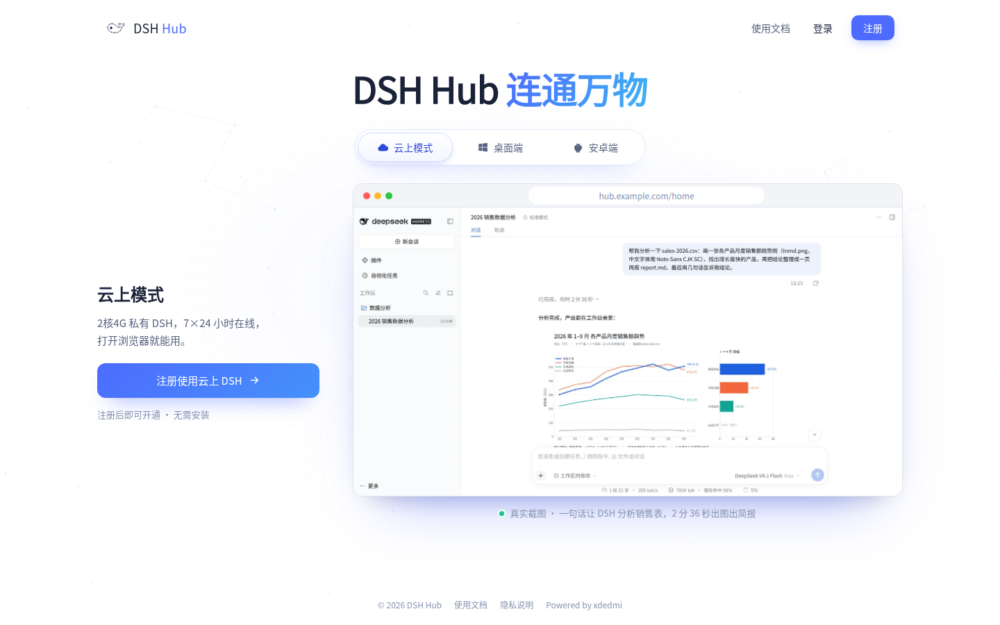 | 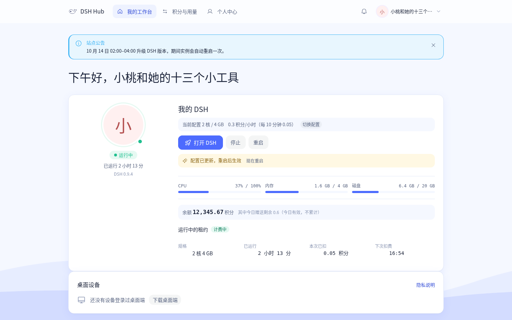 |

用户在工作台里启动 / 休眠自己的 DSH、点「打开 DSH」进入完整的 DSH 网页界面（由 Hub 反向代理到容器），
也能看到自己的插件、模型、积分与导出记录。

**管理台**

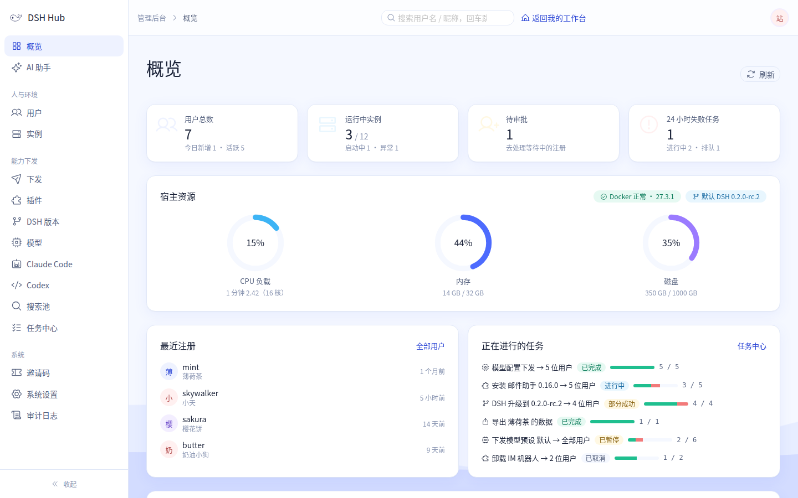

| 用户管理 | 插件库 |
| --- | --- |
| 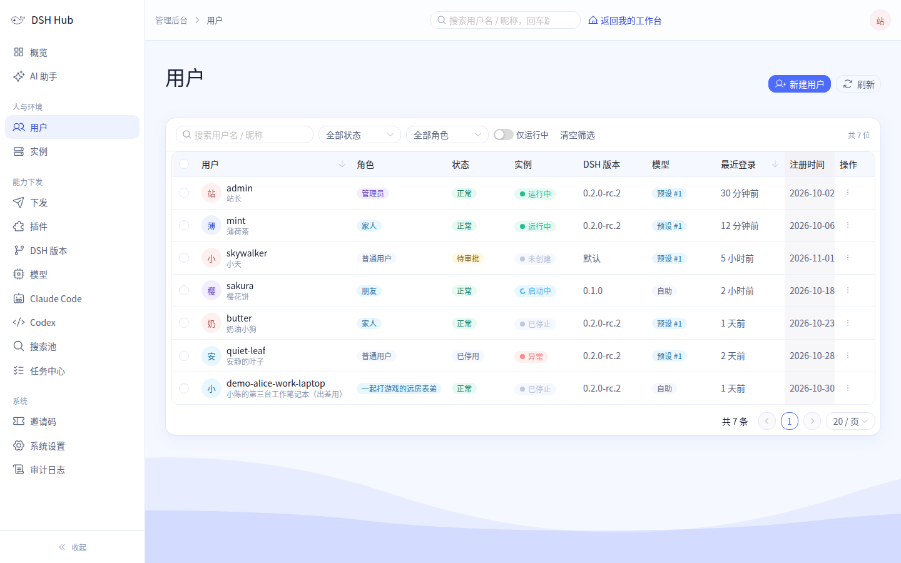 | 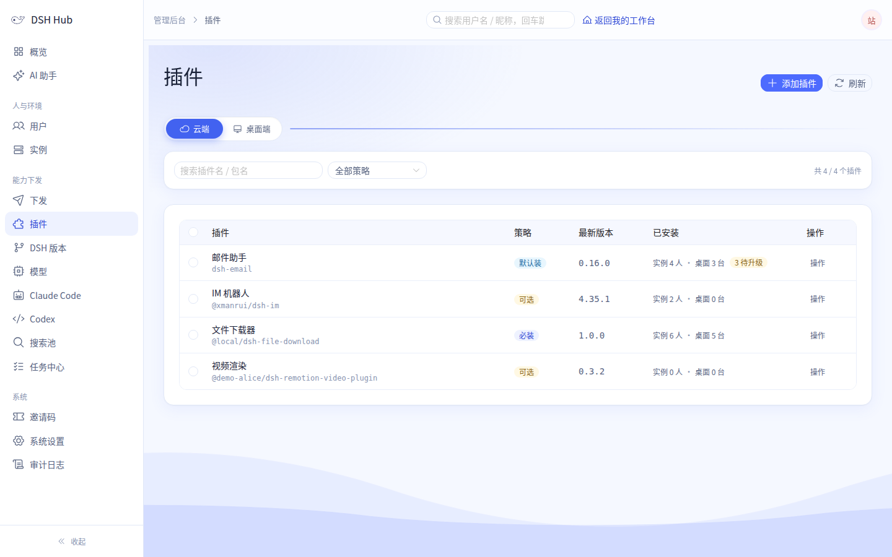 |
| **模型中转站** | **统一下发** |
| 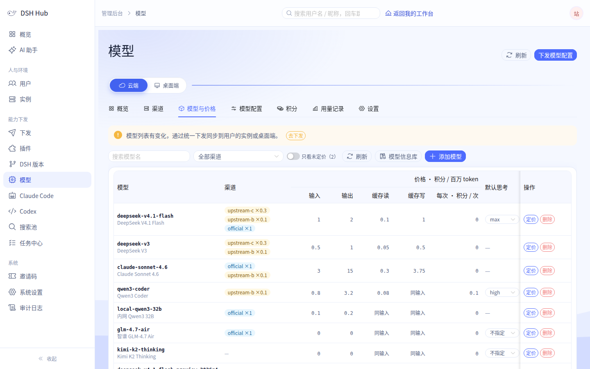 | 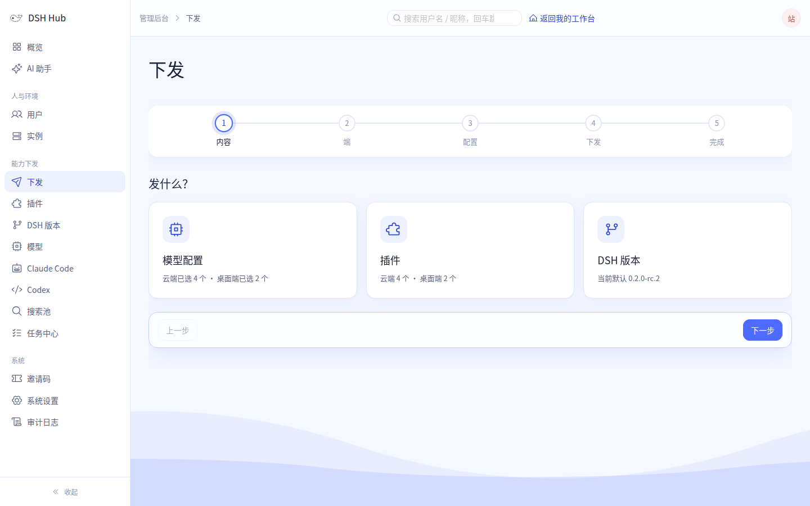 |
| **AI 助手** | **桌面设备** |
| 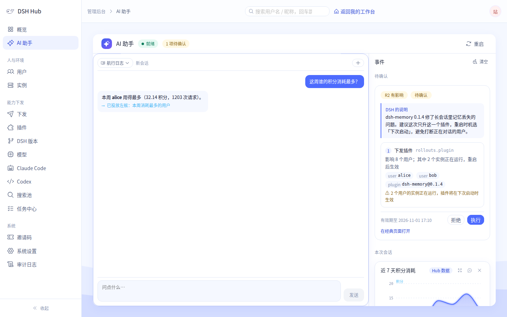 | 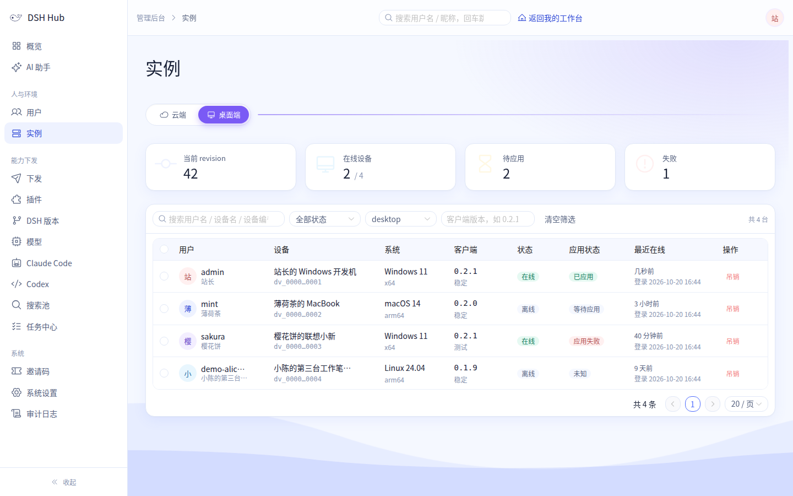 |

管理台的每一页都有「云端 / 桌面」切换：云端指 Hub 上的用户容器，桌面指已登录的桌面客户端，两边的
插件、模型各自独立管理。

**手机端（安卓 App 与手机网页版）**

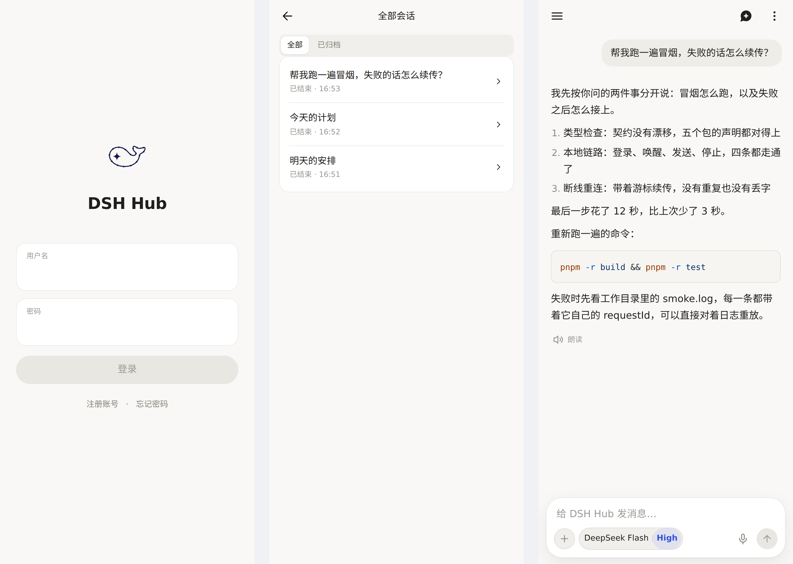

同一套界面有两种形态：安卓 App（Capacitor 壳，可内置多个服务器入口并自动切换）和手机网页版
（Hub 在 `/m/` 托管，手机浏览器访问首页会自动跳过去）。会话列表里同时列出云端 DSH 和用户自己电脑上的
桌面 DSH。

**桌面端**

桌面客户端是 DeepSeek Harness 桌面版的 fork，代码与构建说明在
[dsh-hub-desktop](https://github.com/minghangfeng-maker/dsh-hub-desktop)。它把「DeepSeek 账号登录」换成了
「Hub 账号登录」，其余体验与上游一致，并支持不连 Hub 的离线模式。

### 1.3 能力一览

| 能力 | 说明 |
| --- | --- |
| 账号与权限 | 注册（开放 / 邀请码 / 关闭）、登录、角色、会话与 CSRF、限流、弱口令拦截、管理员敏感操作二次确认 |
| 云端 DSH 容器 | 每人一个容器：只读根文件系统 + 数据卷、cap-drop、内存与磁盘配额、空闲自动休眠、按需唤醒、启动健康检查 |
| 插件管理 | npm / 本地目录 / tgz 入库（入库时扫描密钥）、按用户下发、启用禁用、安装统计、批量操作 |
| DSH 版本管理 | 从 npm 拉版本、构建运行时镜像、冒烟验证、金丝雀 + 并发控制的灰度升级、失败自动回滚 |
| 模型中转站 | OpenAI 兼容 / Anthropic 兼容多渠道路由、密钥池与冷却、倍率与计费、积分钱包、用户自助密钥、用量统计 |
| Claude Code / Codex | 两种对话模式的开通、渠道与价格、按用户下发（配套插件 `plugins/dsh-claude-pilot`、`plugins/dsh-codex-pilot`） |
| 搜索与抓取池 | DeepSeek 官方 Search/Fetch API 与 Tavily 官方 API，按用户额度计费 |
| 算力租赁 | 按小时计费的实例规格、余额与租约、宽限期、管理员免租 |
| 桌面端下发 | 设备授权、插件与配置清单下发、安装包签名与审计、批量吊销 |
| 手机端 | 设备令牌、手机通道（WebSocket 多路复用）、多入口自动切换、安装包记录与自动更新提示 |
| 语音 | 服务端语音识别（`services/asr`，sherpa-onnx + SenseVoice）；朗读接外部 TTS 服务（可选） |
| 运维 | 健康检查、`doctor` 自检、审计日志、备份恢复、数据导出、容器出网防火墙（nftables） |

---

## 二、技术

### 2.1 总体结构

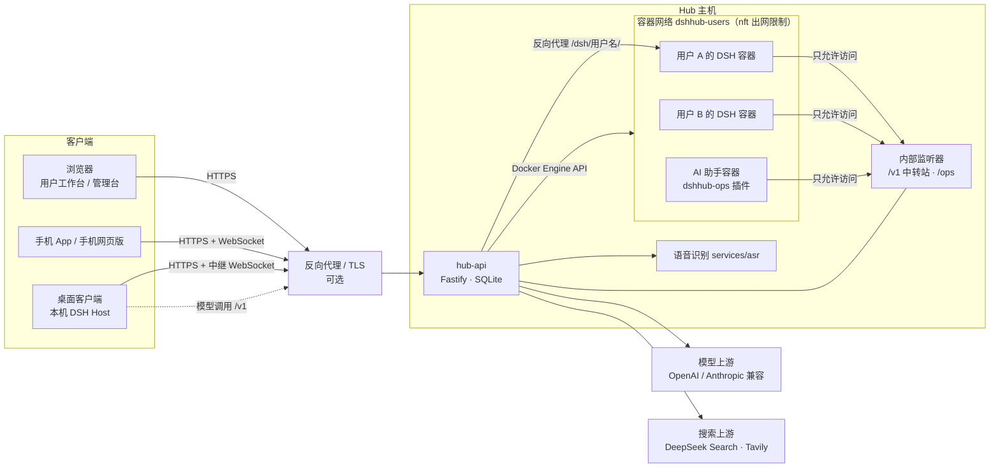

整个服务端**只有一个应用进程** `hub-api`：它同时负责静态托管前端、REST/SSE 接口、反向代理用户容器、
任务引擎、容器编排、模型中转和手机通道。数据库是 SQLite（`node:sqlite`，WAL），容器通过 Docker
Engine API 管理。不需要 Redis、消息队列或单独的网关进程。

### 2.2 各部分是怎么连起来的

**① 浏览器 → 云端 DSH**

1. 用户登录后拿到 Hub 会话 cookie。点「打开 DSH」时，`hub-api` 确保这个用户的容器在运行（没有就按
   用户的 DSH 版本、配额和模型配置创建，然后等健康检查通过）。
2. 浏览器访问 `/dsh/<用户名>/…`，`hub-api` 校验「会话的主人就是这个用户名」，然后把 HTTP / WebSocket /
   SSE 反向代理到容器的 `:3000`，并为这次请求现签一张 DSH 自己的浏览器会话 cookie。
3. 容器端口不发布到宿主，外部只能经 `hub-api` 访问；每次访问会刷新活跃时间，长时间没人用的容器会被
   自动休眠，下次打开时再唤醒。

**② 用户容器 → 模型**

- Hub 为每个用户渲染一份 `managed.patch.yml` 挂进容器，把 DSH 的模型路由指向 Hub 的
  **内部监听器**（`/v1`，只在容器网络的网关地址上监听），并通过环境变量注入该用户专属的中转密钥。
- 中转站按「渠道 → 模型」路由到真实上游（OpenAI / Anthropic 兼容），记录用量、按倍率扣积分；上游密钥
  只在 Hub 内部使用，不会出现在用户容器里。
- 出网防火墙（`deploy/nft/`）禁止容器访问宿主、内网和云元数据地址，只放行内部监听器这一个口子。

**③ 手机 → 任意一个 DSH**

- 手机端用设备令牌登录，打开一条**手机通道**（WebSocket，`/api/mobile/nodes/<节点>/channel`），在上面收发
  `dsh-hub-mobile-v1` 帧：会话列表、新建、发送、流式输出、提问、审批。
- 节点是**云端容器**时，由 `hub-api` 用 [`packages/dsh-node-remote`](packages/dsh-node-remote) 把帧翻译成
  DSH Host 的真实接口去调容器。
- 节点是**用户自己的桌面**时，`hub-api` 把帧经桌面客户端主动连上来的**中继 WebSocket**
  （`/api/desktop/relay`）转给桌面，由桌面端里同一个 `dsh-node-remote` 去调本机 Host。电脑不需要公网 IP，
  也不开任何入站端口。
- 审批永远要人点，超时没人应答也不会自动批准。

**④ 桌面客户端 ↔ Hub**

- 登录走「浏览器授权 + 本机回环 + PKCE」：桌面端拉起浏览器到 Hub 的 `/desktop/authorize`，用户在 Hub
  上确认后，桌面端拿到设备令牌。
- 桌面端定期**拉取**下发清单（`/api/desktop/manifest`：插件、模型配置、最低版本），并上报白名单内的状态字段；
  模型调用经 Hub 中转站计费（每台设备一把中转密钥）。
- Hub 对桌面**只做拉取式下发**：不反向代理、不远程执行、不读取桌面上的文件和会话。

**⑤ 管理员下发**

- 「统一下发」把一次变更（插件安装/升级、DSH 版本、模型配置……）拆成每个目标一条任务，由任务引擎按
  金丝雀 → 放量、并发上限、失败率阈值自动暂停的策略执行，进度经 SSE 实时推到管理台，失败项可以重试。
- 云端目标：直接改容器（装插件、换镜像重建、重渲染配置），失败按旧镜像回滚。桌面目标：写进下发清单，
  等桌面端下次拉取时生效。

**⑥ AI 助手**

- AI 助手本身是一个 DSH（跑在专用容器里），装了 `runtime/plugins/dshhub-ops` 插件，经内部监听器的
  `/ops` 接口调用 Hub 的能力。
- 只读操作直接执行；写操作生成「方案卡」，管理员在管理台（或手机）确认后才真正执行，并记审计。

### 2.3 代码结构与技术栈

```
apps/api                    hub-api：Fastify 5 + node:sqlite + Docker Engine API（唯一的服务端进程）
apps/web                    管理台 + 用户页 + 公开主页：Vue 3.5 + Naive UI + UnoCSS（构建产物由 hub-api 托管）
apps/mobile                 Capacitor 8 安卓壳（Web 资源来自 packages/mobile-ui）
apps/mock-hub               本地假 Hub：不连真 Hub 也能跑通手机端的登录 / 连接 / 发送
packages/shared             前后端共享契约：zod schema、DTO、错误码、常量
packages/mobile-core        手机端核心（与框架无关）：API 客户端、手机通道、会话缓存、入口切换
packages/mobile-ui          手机端界面（Vue 3）；同时产出手机网页版（Hub 托管在 /m/）
packages/dsh-node-remote    手机帧 ↔ DSH Host 接口的薄适配层，Hub 与桌面端共用（MIT）
plugins/                    随 Hub 分发的 DSH 插件（claude-pilot、codex-pilot、memory、file-download、linear-mcp、session-id）
runtime/                    用户容器镜像（Dockerfile、入口、健康检查）；runtime/plugins/dshhub-ops 是 AI 助手插件
services/asr                语音识别服务（Python + sherpa-onnx）
deploy/                     部署示例：systemd 单元、出网防火墙、TLS、升级脚本
scripts/                    运维脚本（备份 / 恢复 / 安全闸门）与手机端构建、端到端运行器
e2e/                        端到端测试（真 Docker + 真浏览器）
docs/design/                设计文档（数据模型、接口、安全、各子系统）
```

| 层 | 选型 |
| --- | --- |
| 运行时 / 包管理 | Node.js 24、pnpm 10（workspace） |
| 服务端 | Fastify 5、zod、`node:sqlite`（WAL，纯 SQL 迁移）、dockerode |
| 前端 | Vue 3.5、Vite、Pinia、Vue Router、Naive UI、UnoCSS |
| 手机端 | Vue 3 + Capacitor 8（安卓）；同一套代码产出手机网页版 |
| 测试 | Vitest（后端 `fastify.inject` + 假容器驱动，前端 @vue/test-utils）、端到端用真 Docker + Chrome |

### 2.4 本地开发

```bash
pnpm install
pnpm build                     # 全部构建（含手机网页版）
pnpm dev                       # api(7701) + web(5171)，打开 http://127.0.0.1:5171
pnpm -r typecheck && pnpm -r lint && pnpm -r --workspace-concurrency=1 test
```

| 命令 | 作用 |
| --- | --- |
| `pnpm --filter @dsh-hub/web dev` 后打开 `/home?mock=1`、`/admin?mock=admin` | 只看界面：前端用内置假数据，不需要后端 |
| `HUB_CONTAINER_DRIVER=fake pnpm dev` | 不需要 Docker：容器启停是内存里的状态机，接口与界面照常可用 |
| `pnpm dev:mobile` + `pnpm mock:hub` | 手机端界面开发，配本地假 Hub 全离线联调 |
| `pnpm apk` | 打 debug APK（需要 JDK 与 Android SDK，见 [`apps/mobile/README.md`](apps/mobile/README.md)） |
| `pnpm --filter @dsh-hub/e2e run e2e` / `pnpm e2e:mobile` | 端到端测试（慢，需要 Docker / Chrome） |

设计文档在 [`docs/design/`](docs/design/)，从 [`01-总体架构`](docs/design/01-总体架构.md) 读起。

---

## 三、在自己的机器上部署

### 3.1 先体验一下（5 分钟，不需要 Docker）

```bash
git clone https://github.com/minghangfeng-maker/dsh-hub.git && cd dsh-hub
corepack enable                          # 用仓库固定的 pnpm 10.33.2
pnpm install && pnpm build
pnpm --filter @dsh-hub/api exec node dist/cli.js create-admin --username admin   # 按提示设密码
HUB_CONTAINER_DRIVER=fake pnpm dev       # 浏览器打开 http://127.0.0.1:5171 ，用 admin 登录
```

`fake` 驱动下不会真的起容器，适合先看管理台和各页面怎么用。数据在仓库下的 `.data/`，删掉即可重来。

### 3.2 正式部署（单机）

**准备**：一台 Linux 服务器（推荐 Ubuntu 22.04 / 24.04，4 核 8 GB 起步，用户多了按每个活跃用户
约 0.5–1 GB 内存估算），装好：

| 依赖 | 版本 | 说明 |
| --- | --- | --- |
| Docker Engine | 24+ | 运行用户容器；部署用户要在 `docker` 组里 |
| Node.js | 24.x | 见 `.nvmrc` |
| pnpm | 10.33.2 | `corepack enable` 即可 |
| nftables | 系统自带 | 出网防火墙（强烈建议） |

**步骤**：

```bash
# 1. 代码与构建
git clone https://github.com/minghangfeng-maker/dsh-hub.git ~/dsh-hub-prod && cd ~/dsh-hub-prod
corepack enable && pnpm install && pnpm build
deploy/prereq.sh                                   # 只读检查：Docker、Node、端口、目录、权限

# 2. 数据目录（systemd 单元默认用 /srv/dsh-hub；站点配置 hub.env 等到对外开放时再建，见 3.3）
sudo mkdir -p /srv/dsh-hub && sudo chown "$USER" /srv/dsh-hub

# 3. 出网防火墙：禁止用户容器访问宿主与内网
sudo deploy/nft/install.sh --print && sudo deploy/nft/install.sh

# 4. 建库、建管理员
HUB_DATA_DIR=/srv/dsh-hub node apps/api/dist/cli.js migrate
HUB_DATA_DIR=/srv/dsh-hub node apps/api/dist/cli.js create-admin --username admin

# 5. 作为 systemd 用户服务运行
mkdir -p ~/.config/systemd/user
ln -sf ~/dsh-hub-prod/deploy/systemd/dsh-hub.service ~/.config/systemd/user/dsh-hub.service
systemctl --user daemon-reload && systemctl --user enable --now dsh-hub
loginctl enable-linger "$USER"                     # 未登录时服务也保持运行

# 6. 自检
curl -s http://127.0.0.1:7700/api/health
HUB_DATA_DIR=/srv/dsh-hub node apps/api/dist/cli.js doctor
```

此时在服务器本机打开 `http://127.0.0.1:7700` 就能用管理员登录。

**第一次进管理台要做的事**：

1. **DSH 版本**：选一个 `@deepseek-ai/dsh` 版本 → 构建运行时镜像（实时日志，第一次要下载基础镜像，
   几分钟）→ 冒烟通过后「设为默认」。
2. **模型**：在「模型中转站」里添加渠道（任意 OpenAI 兼容或 Anthropic 兼容的服务地址 + 密钥），添加模型、
   设好倍率，再设一个默认模型。
3. **用户**：在「系统设置」里选注册方式（开放 / 邀请码 / 关闭），需要的话在「邀请码」里生成邀请码发给用户；
   新用户默认的配额、积分也在「系统设置」里调。
4. （可选）**插件**：在「插件库」里入库插件（npm 包名、tgz 或本地目录），再用「统一下发」装给用户。
   仓库 `plugins/` 下的插件可以直接用。

用户注册登录后，在「我的 DSH」点「打开 DSH」，第一次会创建容器（约十几秒到一分钟），之后就是完整的
DSH 界面。

### 3.3 对外提供访问（域名与 HTTPS）

要让其他人通过公网访问，在前面加一层反向代理并配好证书，然后把对外地址写进站点配置
`~/.config/dsh-hub/hub.env`（从 [`deploy/hub.env.example`](deploy/hub.env.example) 复制，权限 0600，不进仓库），
`systemctl --user restart dsh-hub` 生效：

| 接法 | 适合 | `hub.env` 关键项 |
| --- | --- | --- |
| 四层透传，Hub 自己终结 TLS | 想让 Hub 自己管证书（acme.sh DNS-01，热加载） | `HUB_PUBLIC_ORIGIN=https://hub.example.com`、`HUB_TLS_PORT=7443`、`HUB_PROXY_PROTOCOL=true` |
| 七层终结，代理转发明文 | 已有 nginx / Caddy 管证书 | `HUB_EDGE_PORT=7720`、`HUB_EDGE_ORIGIN=https://hub.example.com` |

两种接法的 nginx / HAProxy 示例、证书签发与续期、升级回滚、备份恢复、常见问题都在
**[`deploy/README.md`](deploy/README.md)**。注意反向代理要透传 WebSocket（手机通道、DSH 会话都依赖它）。

### 3.4 接入手机端与桌面端

- **手机网页版**：不用做任何事，手机浏览器打开你的 Hub 地址会自动进入 `/m/`。
- **安卓 App**：服务器地址不写死在代码里。可以直接装通用 APK、首次启动时在登录页填你的 Hub 地址；也可以
  打一个内置地址的 APK：`VITE_HUB_ORIGINS=https://hub.example.com pnpm apk`（多个地址用逗号分隔，
  App 会自动选能连上的那个）。签名、版本号、发布流程见 [`apps/mobile/README.md`](apps/mobile/README.md)。
  **fork 后请把安卓包名 `tech.dshhub.app` 改成你自己的。**
- **桌面客户端**：在 [dsh-hub-desktop](https://github.com/minghangfeng-maker/dsh-hub-desktop) 里用
  `DSH_HUB_ORIGIN=https://hub.example.com` 构建安装包，再在管理台「DSH 版本」页切到「桌面」上传，用户就能从公开主页下载。

### 3.5 配置参考

所有配置都是环境变量，解析与校验在 [`apps/api/src/config.ts`](apps/api/src/config.ts)（启动时校验，写错直接报错）。
密钥类数据不走环境变量：`HUB_DATA_DIR/secrets/` 下的主密钥、会话密钥首次启动时自动生成（0600）。

<details>
<summary>常用环境变量</summary>

| 变量 | 默认 | 说明 |
| --- | --- | --- |
| `HUB_DATA_DIR` | 仓库下 `.data/` | 数据目录：`hub.db`、`secrets/`、`users/<slug>/`、镜像构建上下文 |
| `HUB_HTTP_PORT` / `HUB_HTTP_HOST` | `7700` / `127.0.0.1` | 本机明文监听器（调试、健康检查） |
| `HUB_PUBLIC_ORIGIN` | `http://127.0.0.1:7700` | 对外地址：CSRF 白名单、生成链接、cookie Secure 推断都用它 |
| `HUB_TLS_PORT` / `HUB_PROXY_PROTOCOL` | `0` / `true` | Hub 自带 TLS 网关（HTTPS + PROXY v1，证书热加载）；`0` = 关闭 |
| `HUB_EDGE_PORT` / `HUB_EDGE_ORIGIN` | `0` / 空 | 七层边缘入口：前置代理终结 TLS 后转发，只认 `X-Real-IP` |
| `HUB_CONTAINER_DRIVER` | `docker` | `docker` 或 `fake` |
| `HUB_CONTAINER_PREFIX` | `dshhub-` | 容器名前缀 |
| `HUB_USERS_NETWORK` / `HUB_USERS_SUBNET` | `dshhub-users` / `10.213.0.0/16` | 用户容器网络与网段（出网防火墙按它匹配） |
| `HUB_RELAY_INTERNAL_PORT` / `HUB_RELAY_INTERNAL_HOST` | `7710` / 自动探测 | 容器访问中转站与 `/ops` 的内部监听器；`0` = 关闭 |
| `HUB_NPM_REGISTRY` | `https://registry.npmmirror.com` | 构建镜像、容器内装插件用的 npm 源 |
| `HUB_PUBLIC_ASSETS_ORIGIN` | 空 | 安装包等静态资产的独立基址；空 = 由 Hub 自己提供 |
| `HUB_COOKIE_SECURE` / `HUB_HSTS_MAX_AGE` | 按地址推断 / `86400` | cookie Secure 与 HSTS（`0` = 不发） |
| `HUB_MOBILE_ORIGINS` | `https://localhost,capacitor://localhost` | 手机 App 的 Origin 白名单（CORS） |
| `HUB_MOBILE_WEB_DIR` | `packages/mobile-ui/dist-web` | 手机网页版 `/m/` 的产物目录 |
| `HUB_ASR_URL` / `HUB_ASR_ENABLED` | `http://127.0.0.1:9890` / `true` | 语音识别服务（`services/asr`） |
| `HUB_TTS_URL` / `HUB_TTS_ENABLED` | `http://127.0.0.1:9880` / `true` | 朗读合成服务（外部服务，可选） |
| `HUB_LOG_LEVEL` | `info` | 日志级别 |
| `DOCKER_HOST` | `unix:///var/run/docker.sock` | Docker Engine 地址 |

完整清单（各模块的限流、超时、缓存与配额）见 `config.ts` 的 `configSchema`；样例见
[`deploy/hub.env.example`](deploy/hub.env.example)。

</details>

---

## 品牌与许可

- 项目名是 **DSH Hub**。本项目不是 DeepSeek 官方项目，请不要使用 DeepSeek 的名称、Logo 或鲸鱼素材暗示
  官方关系。项目自己的品牌素材在 `scripts/assets/brand/`。
- npm 包都在 `@dsh-hub/*` 作用域下（AI 助手插件是 `@dshhub/ops`）。
- 许可证：仓库整体 **Apache-2.0**（见 [LICENSE](LICENSE) 与 [NOTICE](NOTICE)）；
  `packages/dsh-node-remote` 是 **MIT**（与桌面端共用）。

## 参与

欢迎 issue 和 PR，见 [CONTRIBUTING.md](CONTRIBUTING.md)。
安全问题请**不要**开公开 issue，按 [SECURITY.md](SECURITY.md) 通过 GitHub 私密漏洞报告提交。
